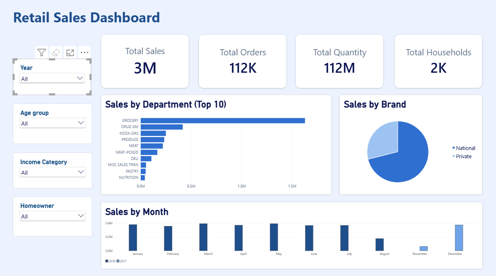

# Retail Sales Dashboard (Power BI)

Power BI Assignment 1 (Data Modeling) - Route Academy.

## Preview

## Overview
Retail sales dashboard built in Power BI from four CSV files (order lines, orders, products, household demographics).

## What I did
- Power Query: split the flat data into 1 fact table (`Fact_Sales`) and 4 dimensions (`Dim_Product`, `Dim_Household`, `Dim_Store`, `Dim_Date`).
- Model view: star schema with 4 one-to-many relationships.
- DAX measures: Total Sales, Total Quantity, Total Orders, Total Households, Avg Order Value.
- Dashboard: 4 KPI cards, 4 slicers, bar, pie and column charts, light color theme.

## Assumptions & limitations
- **Dates:** the `DAY` column is a sequence number (1-711), not a real date. `Dim_Date` was built assuming day 1 = 2017-01-01.
- **Geography:** the dataset has no geographic fields (stores are identified only by a numeric `STORE_ID`), so the analysis focuses on products, households and time.
- **Missing demographics:** households that do not appear in the demographics file are labeled `Unknown`.
- **Data cleaning:** rows with `QUANTITY = 0` were removed from the fact table.
